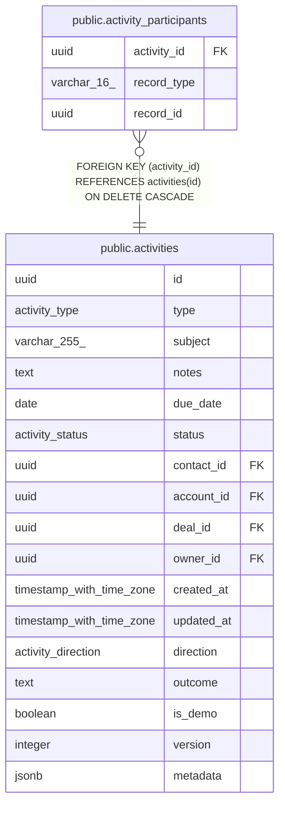

# public.activity_participants

## Description

The contacts and leads an Email activity concerns, from its message's links at filing. GDPR erasure redacts every activity associated with the erased record. record_type + record_id is polymorphic with no FK: hard deletes clear their rows, lead conversion and contact merge move them.

## Columns

| Name | Type | Default | Nullable | Children | Parents | Comment |
| ---- | ---- | ------- | -------- | -------- | ------- | ------- |
| activity_id | uuid |  | false |  | [public.activities](public.activities.md) |  |
| record_type | varchar(16) |  | false |  |  |  |
| record_id | uuid |  | false |  |  |  |

## Constraints

| Name | Type | Definition |
| ---- | ---- | ---------- |
| activity_participants_record_type_check | CHECK | CHECK (((record_type)::text = ANY ((ARRAY['contact'::character varying, 'lead'::character varying])::text[]))) |
| activity_participants_activity_id_fkey | FOREIGN KEY | FOREIGN KEY (activity_id) REFERENCES activities(id) ON DELETE CASCADE |
| activity_participants_pkey | PRIMARY KEY | PRIMARY KEY (activity_id, record_type, record_id) |

## Indexes

| Name | Definition |
| ---- | ---------- |
| activity_participants_pkey | CREATE UNIQUE INDEX activity_participants_pkey ON public.activity_participants USING btree (activity_id, record_type, record_id) |
| activity_participants_record_idx | CREATE INDEX activity_participants_record_idx ON public.activity_participants USING btree (record_type, record_id) |

## Relations

---

> Generated by [tbls](https://github.com/k1LoW/tbls)
