# public.email_send_intents

## Description

A send recorded before it reaches the provider. Holds what only this application knows about the send so the message can be filed to its record even when storing it after the send failed.

## Columns

| Name | Type | Default | Nullable | Children | Parents | Comment |
| ---- | ---- | ------- | -------- | -------- | ------- | ------- |
| id | uuid | gen_random_uuid() | false | [public.email_send_ledger](public.email_send_ledger.md) |  |  |
| user_id | uuid |  | false |  | [public.users](public.users.md) |  |
| connected_account_id | uuid |  | false |  | [public.connected_accounts](public.connected_accounts.md) |  |
| rfc_message_id | text |  | false |  |  | The Message-ID this application generated, without angle brackets. Matches the Sent copy when the provider id is unknown. |
| provider_message_id | text |  | true |  |  |  |
| record_type | varchar(16) |  | true |  |  |  |
| record_id | uuid |  | true |  |  |  |
| activity_notes | text |  | true |  |  |  |
| actor_name | text |  | false |  |  |  |
| to_addresses | text[] | '{}'::text[] | false |  |  |  |
| cc_addresses | text[] | '{}'::text[] | false |  |  |  |
| status | varchar(16) | 'pending'::character varying | false |  |  | pending: not yet answered. not_sent: the provider refused and nothing went. sent: accepted, not yet filed. unconfirmed: the outcome is unknown. filed: stored, linked and given its activity. |
| email_message_id | uuid |  | true |  | [public.email_messages](public.email_messages.md) |  |
| created_at | timestamp with time zone | now() | false |  |  |  |
| updated_at | timestamp with time zone | now() | false |  |  |  |
| filed_at | timestamp with time zone |  | true |  |  |  |
| idempotency_key | uuid |  | false |  |  | The client's Idempotency-Key, one per compose. A repeat answers from this row instead of sending again. |
| request_hash | text |  | false |  |  | SHA-256 of the parsed request, keys sorted, so a key reused for different mail is refused rather than replayed. |
| unresolved_merge_tags | text[] | '{}'::text[] | false |  |  | Template tags the first send could not resolve, so a replay answers exactly as it did. |
| thread_private | boolean | false | false |  |  | True when the message answered or forwarded was in a private thread at claim time. Its filing then stores the message private and files an activity without a body. |
| parent_message_id | uuid |  | true |  | [public.email_messages](public.email_messages.md) | The message this send answers or forwards; null for a new conversation. Lets a privacy change reach a send not yet stored. |
| recipient_contact_ids | uuid[] | '{}'::uuid[] | false |  |  | Contacts whose address the recipients named at claim time; erasure finds the intent by them. |
| recipient_lead_ids | uuid[] | '{}'::uuid[] | false |  |  | Unconverted leads the recipients named at claim time where no contact held the address. |

## Constraints

| Name | Type | Definition |
| ---- | ---- | ---------- |
| email_send_intents_record_pair_check | CHECK | CHECK (((record_type IS NULL) = (record_id IS NULL))) |
| email_send_intents_record_type_check | CHECK | CHECK (((record_type)::text = ANY ((ARRAY['contact'::character varying, 'lead'::character varying, 'account'::character varying, 'deal'::character varying])::text[]))) |
| email_send_intents_status_check | CHECK | CHECK (((status)::text = ANY ((ARRAY['pending'::character varying, 'not_sent'::character varying, 'sent'::character varying, 'unconfirmed'::character varying, 'filed'::character varying])::text[]))) |
| email_send_intents_user_id_fkey | FOREIGN KEY | FOREIGN KEY (user_id) REFERENCES users(id) ON DELETE CASCADE |
| email_send_intents_connected_account_id_fkey | FOREIGN KEY | FOREIGN KEY (connected_account_id) REFERENCES connected_accounts(id) ON DELETE CASCADE |
| email_send_intents_email_message_id_fkey | FOREIGN KEY | FOREIGN KEY (email_message_id) REFERENCES email_messages(id) ON DELETE SET NULL |
| email_send_intents_parent_message_id_fkey | FOREIGN KEY | FOREIGN KEY (parent_message_id) REFERENCES email_messages(id) ON DELETE SET NULL |
| email_send_intents_pkey | PRIMARY KEY | PRIMARY KEY (id) |
| email_send_intents_rfc_unique | UNIQUE | UNIQUE (connected_account_id, rfc_message_id) |
| email_send_intents_idempotency_unique | UNIQUE | UNIQUE (user_id, idempotency_key) |

## Indexes

| Name | Definition |
| ---- | ---------- |
| email_send_intents_pkey | CREATE UNIQUE INDEX email_send_intents_pkey ON public.email_send_intents USING btree (id) |
| email_send_intents_rfc_unique | CREATE UNIQUE INDEX email_send_intents_rfc_unique ON public.email_send_intents USING btree (connected_account_id, rfc_message_id) |
| email_send_intents_provider_unique | CREATE UNIQUE INDEX email_send_intents_provider_unique ON public.email_send_intents USING btree (connected_account_id, provider_message_id) WHERE (provider_message_id IS NOT NULL) |
| email_send_intents_user_idx | CREATE INDEX email_send_intents_user_idx ON public.email_send_intents USING btree (user_id) |
| email_send_intents_message_idx | CREATE INDEX email_send_intents_message_idx ON public.email_send_intents USING btree (email_message_id) WHERE (email_message_id IS NOT NULL) |
| email_send_intents_unsettled_idx | CREATE INDEX email_send_intents_unsettled_idx ON public.email_send_intents USING btree (updated_at) WHERE ((status)::text = ANY ((ARRAY['pending'::character varying, 'sent'::character varying])::text[])) |
| email_send_intents_idempotency_unique | CREATE UNIQUE INDEX email_send_intents_idempotency_unique ON public.email_send_intents USING btree (user_id, idempotency_key) |
| email_send_intents_parent_message_idx | CREATE INDEX email_send_intents_parent_message_idx ON public.email_send_intents USING btree (parent_message_id) WHERE (parent_message_id IS NOT NULL) |

## Relations

```mermaid
erDiagram

"public.email_send_ledger" }o--o| "public.email_send_intents" : "FOREIGN KEY (intent_id) REFERENCES email_send_intents(id) ON DELETE SET NULL"
"public.email_send_intents" }o--|| "public.users" : "FOREIGN KEY (user_id) REFERENCES users(id) ON DELETE CASCADE"
"public.email_send_intents" }o--|| "public.connected_accounts" : "FOREIGN KEY (connected_account_id) REFERENCES connected_accounts(id) ON DELETE CASCADE"
"public.email_send_intents" }o--o| "public.email_messages" : "FOREIGN KEY (email_message_id) REFERENCES email_messages(id) ON DELETE SET NULL"
"public.email_send_intents" }o--o| "public.email_messages" : "FOREIGN KEY (parent_message_id) REFERENCES email_messages(id) ON DELETE SET NULL"

"public.email_send_intents" {
  uuid id ""
  uuid user_id FK ""
  uuid connected_account_id FK ""
  text rfc_message_id "The Message-ID this application generated, without angle brackets. Matches the Sent copy when the provider id is unknown."
  text provider_message_id ""
  varchar_16_ record_type ""
  uuid record_id ""
  text activity_notes ""
  text actor_name ""
  text__ to_addresses ""
  text__ cc_addresses ""
  varchar_16_ status "pending: not yet answered. not_sent: the provider refused and nothing went. sent: accepted, not yet filed. unconfirmed: the outcome is unknown. filed: stored, linked and given its activity."
  uuid email_message_id FK ""
  timestamp_with_time_zone created_at ""
  timestamp_with_time_zone updated_at ""
  timestamp_with_time_zone filed_at ""
  uuid idempotency_key "The client's Idempotency-Key, one per compose. A repeat answers from this row instead of sending again."
  text request_hash "SHA-256 of the parsed request, keys sorted, so a key reused for different mail is refused rather than replayed."
  text__ unresolved_merge_tags "Template tags the first send could not resolve, so a replay answers exactly as it did."
  boolean thread_private "True when the message answered or forwarded was in a private thread at claim time. Its filing then stores the message private and files an activity without a body."
  uuid parent_message_id FK "The message this send answers or forwards; null for a new conversation. Lets a privacy change reach a send not yet stored."
  uuid__ recipient_contact_ids "Contacts whose address the recipients named at claim time; erasure finds the intent by them."
  uuid__ recipient_lead_ids "Unconverted leads the recipients named at claim time where no contact held the address."
}
"public.email_send_ledger" {
  uuid id ""
  uuid user_id FK ""
  uuid intent_id FK ""
  timestamp_with_time_zone created_at ""
}
"public.users" {
  uuid id ""
  varchar_255_ email ""
  text password_hash ""
  varchar_255_ name ""
  varchar_20_ role ""
  varchar_10_ status ""
  timestamp_with_time_zone created_at ""
  timestamp_with_time_zone updated_at ""
  boolean must_change_password ""
  varchar_10_ preferred_language ""
  varchar_64_ password_reset_token_hash ""
  timestamp_with_time_zone password_reset_expires_at ""
  timestamp_with_time_zone password_changed_at ""
  boolean notify_overdue_tasks ""
  boolean notify_assignments ""
  boolean notify_deal_stage_changes ""
  boolean mfa_enabled ""
  text mfa_secret ""
  text mfa_pending_secret ""
  text__ mfa_recovery_codes ""
  boolean onboarding_completed ""
  timestamp_with_time_zone onboarding_completed_at ""
  varchar_20_ sso_provider "SSO protocol that provisioned this user: saml | oidc"
  text sso_subject "Stable external identity: SAML nameID or OIDC sub claim"
  text api_token_hash ""
  timestamp_with_time_zone api_token_issued_at ""
  text scim_external_id ""
  varchar_255_ territory "Free-text sales territory a rep is assigned to, matched against leads.territory for routing suggestions (MINCRM-475)."
  varchar_20_ nav_layout "Personal navigation layout. NULL means follow the workspace default in system_settings.nav_layout, so a later admin change still propagates."
}
"public.connected_accounts" {
  uuid id ""
  uuid user_id FK ""
  varchar_16_ provider ""
  text email_address ""
  text auth_encrypted ""
  text__ granted_scopes "Scopes the provider actually granted, which may be fewer than were requested."
  varchar_16_ status ""
  text status_detail ""
  timestamp_with_time_zone last_sync_at ""
  text sync_cursor ""
  smallint key_version "Key version used to encrypt auth_encrypted. References ENCRYPTION_KEY_V<n> env var."
  timestamp_with_time_zone created_at ""
  timestamp_with_time_zone updated_at ""
  integer sync_failure_count "Consecutive failed sync attempts. Drives the retry delay and the ceiling past which a mailbox is no longer claimed; reset when a connection test succeeds."
  timestamp_with_time_zone sync_next_attempt_at "Earliest time this mailbox may be synced again. Null means due now while sync_failure_count is below the ceiling, and parked-until-a-user-acts once it reaches it; the two columns gate the claim together."
  text__ excluded_domains "Domains this mailbox's owner never wants synced, lowercased. A message is skipped at sync time when every counterparty address is on one of these or on the org list."
  timestamp_with_time_zone sync_paused_at "When the owner paused sync, or NULL when it runs. Kept apart from status, which reports connection health and is rewritten by every synced page."
  boolean is_demo "True for the demo seed's mailbox, which demo removal deletes by this flag."
}
"public.email_messages" {
  uuid id ""
  uuid connected_account_id FK ""
  text provider_message_id "The provider's own message identifier, opaque here. Unique per connected account, which is what makes a repeated sync idempotent."
  text thread_id "Normalized across providers: native thread id where one exists, otherwise derived from RFC 5322 References/In-Reply-To/Message-ID."
  varchar_16_ direction ""
  text from_address ""
  text__ to_addresses ""
  text__ cc_addresses ""
  text subject ""
  boolean has_attachments ""
  timestamp_with_time_zone sent_at ""
  boolean is_private "Restricts a message to the mailbox owner; enforced at the service layer."
  timestamp_with_time_zone created_at ""
  text message_body_text "Plain-text body. Taken from the text part where one exists, otherwise converted from the HTML part so a message reads the same either way. Null when neither part exists or the document could not be parsed."
  text message_body_html "HTML body exactly as the sender wrote it, stored UNSANITIZED. Nothing renders it today; whatever first does must sanitize at render, since sanitizing here would discard markup a renderer needs."
  text message_snippet "First 200 characters of the plain-text body with whitespace collapsed, for list views that must not load a whole body. Derived from message_body_text, so it is null whenever that is."
  text rfc_message_id "The message's own RFC 5322 Message-ID, without angle brackets. A reply names it in In-Reply-To."
  text references_header "Ancestor Message-IDs, bracketed and space-separated, oldest first; bounded to the root plus the newest. A reply extends it."
  text__ reply_to_addresses "Addresses the sender named in Reply-To, lowercased. Empty when there is none or it names only the sender; a reply then goes to from_address."
  timestamp_with_time_zone gdpr_redacted_at "When GDPR erasure redacted this message. A re-sync never overwrites a redacted row, so the redaction survives the provider still holding the original."
}
```

---

> Generated by [tbls](https://github.com/k1LoW/tbls)
