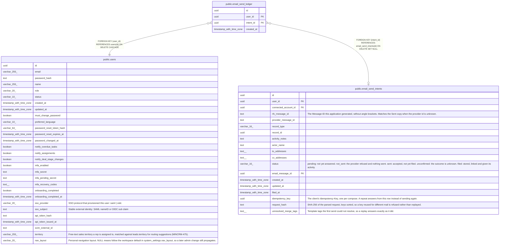

# public.email_send_ledger

## Description

One row per send that may have gone out, counted against the user's hourly ceiling. Outlives the mailbox and the send intent, so disconnecting a mailbox cannot reset the count.

## Columns

| Name | Type | Default | Nullable | Children | Parents | Comment |
| ---- | ---- | ------- | -------- | -------- | ------- | ------- |
| id | uuid | gen_random_uuid() | false |  |  |  |
| user_id | uuid |  | false |  | [public.users](public.users.md) |  |
| intent_id | uuid |  | true |  | [public.email_send_intents](public.email_send_intents.md) |  |
| created_at | timestamp with time zone | now() | false |  |  |  |

## Constraints

| Name | Type | Definition |
| ---- | ---- | ---------- |
| email_send_ledger_user_id_fkey | FOREIGN KEY | FOREIGN KEY (user_id) REFERENCES users(id) ON DELETE CASCADE |
| email_send_ledger_intent_id_fkey | FOREIGN KEY | FOREIGN KEY (intent_id) REFERENCES email_send_intents(id) ON DELETE SET NULL |
| email_send_ledger_pkey | PRIMARY KEY | PRIMARY KEY (id) |

## Indexes

| Name | Definition |
| ---- | ---------- |
| email_send_ledger_pkey | CREATE UNIQUE INDEX email_send_ledger_pkey ON public.email_send_ledger USING btree (id) |
| email_send_ledger_user_time_idx | CREATE INDEX email_send_ledger_user_time_idx ON public.email_send_ledger USING btree (user_id, created_at) |
| email_send_ledger_intent_idx | CREATE INDEX email_send_ledger_intent_idx ON public.email_send_ledger USING btree (intent_id) WHERE (intent_id IS NOT NULL) |

## Relations

---

> Generated by [tbls](https://github.com/k1LoW/tbls)
