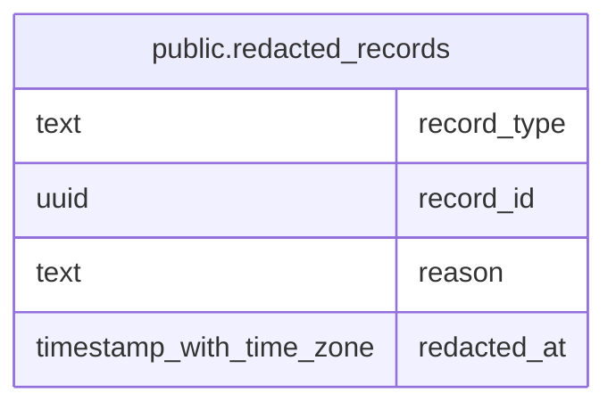

# public.redacted_records

## Description

Records whose content reads masked. An activity: subject and text removed (GDPR erasure or a private thread); audit reads mask an erased one's entries, and a scrubbed one's written before redacted_at. An audit_log entry: a private thread's send, whose recipients and linked records read [Private]. Kept after the record is deleted.

## Columns

| Name | Type | Default | Nullable | Children | Parents | Comment |
| ---- | ---- | ------- | -------- | -------- | ------- | ------- |
| record_type | text |  | false |  |  |  |
| record_id | uuid |  | false |  |  |  |
| reason | text |  | false |  |  |  |
| redacted_at | timestamp with time zone | now() | false |  |  |  |

## Constraints

| Name | Type | Definition |
| ---- | ---- | ---------- |
| redacted_records_reason_check | CHECK | CHECK ((reason = ANY (ARRAY['gdpr_erasure'::text, 'private_thread'::text]))) |
| redacted_records_record_type_check | CHECK | CHECK ((record_type = ANY (ARRAY['activity'::text, 'audit_log'::text]))) |
| redacted_records_pkey | PRIMARY KEY | PRIMARY KEY (record_type, record_id) |

## Indexes

| Name | Definition |
| ---- | ---------- |
| redacted_records_pkey | CREATE UNIQUE INDEX redacted_records_pkey ON public.redacted_records USING btree (record_type, record_id) |

## Relations

---

> Generated by [tbls](https://github.com/k1LoW/tbls)
